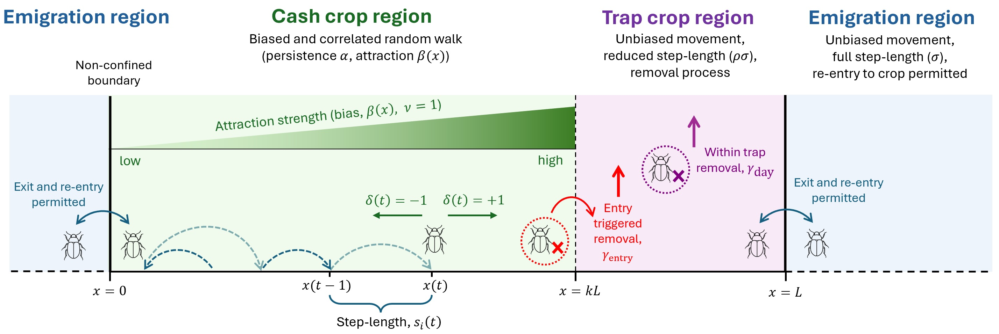

# Insect movement and spatial dynamics determine trap crop effectiveness

This repository contains the model schematic (Figure 1) and the MATLAB scripts and reference plots for Figures 2–8 of *Insect movement and spatial dynamics determine trap crop effectiveness* (Ahmed et al., 2026, *Ecological Modelling*).

## Model overview

The model simulates individual insect movements in a one-dimensional field with a cash crop and an adjoining trap-crop strip. In the cash crop, a biased correlated random walk represents directional persistence and attraction towards the trap crop. The simulations vary the strength and spatial reach of attraction, the width of the trap crop, and the processes that act once insects reach it.

*Figure 1. Insects can leave and re-enter the field at either boundary. Movement is unbiased outside the field and within the trap crop, where behavioural arrestment can reduce step lengths. The schematic illustrates an attraction profile that increases linearly towards the trap-crop boundary.*

Insects can be removed when they enter the trap crop or during their residence. The model tracks four outcomes as percentages of the initial population: cash-crop occupancy, trap-crop occupancy, cumulative removal, and the proportion currently outside the field.

## Figures and scripts

| Figure | Contents |
| --- | --- |
| 1 | Model schematic showing the field layout, movement rules, and two removal mechanisms. Provided as a PNG. |
| 2 | Baseline insect distributions at days 0, 2, and 30, with time series for all four population outcomes. |
| 3 | Effects of attraction strength and spatial reach under two allocations of land to the cash and trap crops. |
| 4–5 | Line plots and heatmaps of cash-crop occupancy across directional persistence and environmental bias settings. |
| 6 | Thirty-day comparison of six scenarios that vary entry interception, within-trap removal, and arrestment. |
| 7 | Effects of trap-crop width on day-15 outcomes under the same six scenarios. |
| 8 | Heatmaps of day-15 removal and trap-crop occupancy across entry and within-trap removal probabilities at three arrestment levels. |

## Running the scripts

The scripts for Figures 2–8 are written for MATLAB R2016a or later and require no additional toolboxes. Download or clone the repository, open the script corresponding to the figure you want to reproduce, and select **Run** in the MATLAB Editor. Each script specifies its simulation settings and uses a fixed random seed. The accompanying PNG files provide reference plots.

## Citation

Ahmed, D. A., et al. (2026). Insect movement and spatial dynamics determine trap crop effectiveness. *Ecological Modelling*, 111916. https://doi.org/10.1016/j.ecolmodel.2026.111916
